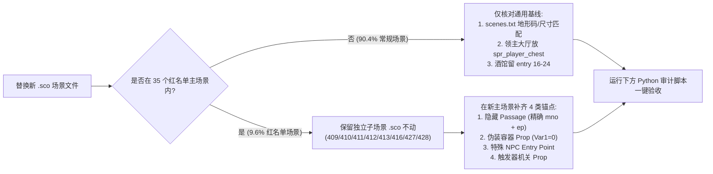

# 聚落场景替换红名单与原版机制无损迁移手册 (`Carpathian Solid & Shade`)

> [!IMPORTANT]
> 全模组 148 座历史聚落（18 城 + 40 堡 + 90 村）共对应 **366 个常规聚落 `.sco` 场景槽位**。经对 [scenes.txt](file:///home/wxm/GOG%20Games/Mount%20Blade%20Warband/game/Modules/Carpathian%20Solid%20&%20Shade/scenes.txt)、[scene_props.txt](file:///home/wxm/GOG%20Games/Mount%20Blade%20Warband/game/Modules/Carpathian%20Solid%20&%20Shade/scene_props.txt)、[troops.txt](file:///home/wxm/GOG%20Games/Mount%20Blade%20Warband/game/Modules/Carpathian%20Solid%20&%20Shade/troops.txt) 静态站点字段、`SceneObj/*.sco` 二进制实体以及全部 6 套字节码文件的交叉全量取证，**仅有 34 座历史聚落名下的 35 个具体 `.sco` 场景文件（占全部历史聚落 `.sco` 的 `9.56%`）挂载了原版 *Solid & Shade* 专属机关、暗门、伪装宝箱或特殊剧情 NPC**。其余 **331 个（`90.44%`）** 常规聚落 `.sco` 场景只需遵守通用出生点与领主箱规范即可直接替换。

---

## 一、 绝对禁动：第 19 城（亡灵专属隐藏主城）

| Party ID | 1521 名称 | 开局归属势力 | 主场景组 (`scn_town_19_*`) | 关联子场景 | 进入方式与核心机制 |
| :--- | :--- | :--- | :--- | :--- | :--- |
| `[37] p_town_19` | **厄瑞玻斯冥府之门** (`The_Unknown`) | `[20] fac_kingdom_6` **神秘力量**（领主：`万魔之父堤丰`） | `[60]` `center`、`[79]` `castle`、`[98]` `tavern`、`[117]` `store`、`[136]` `arena`、`[155]` `prison`、`[174]` `walls`、`[193]` `alley` | `[417] scn_necropolis_fates`（命运三女神殿） | 由 `[125] 罗多斯楚克` 冥界渡口解锁航线后抵达。包含喷血池、拉斯普京、乌鸦、福吐纳托、棉花糖坩埚、筛盐场与死灵飞升终局，**严禁替换任何 `.sco` 或改动 [scenes.txt](file:///home/wxm/GOG%20Games/Mount%20Blade%20Warband/game/Modules/Carpathian%20Solid%20&%20Shade/scenes.txt) 配置**。 |

---

## 二、 历史聚落红名单总表（34 座聚落 / 35 个主 `.sco` + 8 个独立子 `.sco`）

> [!TIP]
> 城镇与城堡的特殊机制**精确到具体子场景**（例如 `[21] 锡比乌` 只有杂货铺 `scn_town_3_store` 有机关，它的街道 `center`、攻城 `walls`、大厅 `castle`、酒馆 `tavern`、监狱 `prison`、竞技场 `arena` 完全属于普通场景，可自由替换）。

### 2.1 历史城镇红名单（12 座城 / 13 个主 `.sco` + 4 个独立子 `.sco`）

| Party ID & 1521 城名 | 开局归属势力（及初始领主） | 受保护主场景 (`SceneObj/*.sco`) | 关联独立子场景 (`.sco`) | 玩家进入方式 | 场景内核心机制 / 必保物件 / 掉落 |
| :--- | :--- | :--- | :--- | :--- | :--- |
| `[20] p_town_2`<br>**布加勒斯特** (`Bucharest`) | **瓦拉几亚公国** (`fac_kingdom_4`)<br>`克拉约瓦大班普雷达` | `[43] scn_town_2_center`<br>`[81] scn_town_2_tavern` | 无 | ① 城镇菜单→逛街进 `[43]`<br>② 城镇菜单→去酒馆进 `[81]` | • `[43]`：隐藏木箱 `spr_container_small_chest (var1=0)` → `[800] trp_bonus_chest_3`（`奇怪的头盔` + `奇怪的大剑`）；捕鼠夹白名单<br>• `[81]`：酒馆 `entry=16` 刷 `奴隶贸易者拉蒙`，当 `$Necropolis == 13` 时由 `mst_town_default L87` 自动移除 |
| `[21] p_town_3`<br>**锡比乌** (`Sibiu`) | **匈牙利王国** (`fac_kingdom_1`)<br>`佩雷尼·彼得总督` | `[101] scn_town_3_store` | 无 | 城镇菜单→见杂货商（或从街道进杂货铺门） | 室内摆放伪装酒桶容器 `spr_caskofamontillado (var1=0)` + 暗记 `spr_thirteen` + `spr_humanskull` → `[801] trp_bonus_chest_4`（秘籍 **`白葡萄酒酒桶 itm_book_amontillado`** + 血液 + 酒/肉饼/奶酪） |
| `[23] p_town_5`<br>**克劳森堡** (`Kolozsvar`) | **匈牙利王国** (`fac_kingdom_1`)<br>`扎波利亚·亚诺什大总督` | `[46] scn_town_5_center` | 无 | 城镇菜单→到镇中心转转 | 隐藏木箱 `spr_container_small_chest (var1=0)` → `[799] trp_bonus_chest_2`（`奇怪的靴子` + `奇怪的剑`）；捕鼠夹白名单 |
| `[24] p_town_6`<br>**布达** (`Buda`) | **匈牙利王国** (`fac_kingdom_1`)<br>`路易二世国王` | `[142] scn_town_6_prison` | **`[409] scn_town_6_catacombs`**<br>（地下墓穴，禁换） | 进布达监狱 `[142]` → 走到贴有 `spr_thirteen` 与 `spr_montresor` 的暗墙处按 `F` 触发隐藏 **`Passage (mno=17, entry=0)`** → 调用 `mno_town_catacombs` 进 `[409]` | 子场景 `[409]` `entry=0` 入场，`entry=1` 静态驻留 `trp_npc18 (福吐纳托)`，内设伪装砖墙容器 `spr_catacombswall (var1=0)` → `[823] trp_bonus_chest_26` |
| `[27] p_town_9`<br>**雅西** (`Jassy`) | **摩尔达维亚公国** (`fac_kingdom_2`)<br>`卢卡·阿尔博雷大内侍` | `[88] scn_town_9_tavern` | **`[410] scn_town_9_basement`**<br>（酒馆地窖，禁换） | 进雅西酒馆 `[88]` → 在带 `spr_thirteen` 暗记的门前触发隐藏 **`Passage (mno=18, entry=0)`** → 调用 `mno_town_basement` 进 `[410]` | 子场景 `[410]` `entry=0` 入场，地板下设伪装心脏容器 `spr_telltaleheart (var1=0)` → `[802] trp_bonus_chest_5`（秘籍 **`泄密的心 itm_book_telltale`** + 尸体/肌肉/皮肤/骨骼） |
| `[29] p_town_11`<br>**霍京** (`Hotin`) | **摩尔达维亚公国** (`fac_kingdom_2`)<br>`申德雷亚门警总管` | `[52] scn_town_11_center` | 无 | 城镇菜单→到镇中心转转 | 街道 **`entry=8`** 静态驻留树精同伴 `trp_npc21 (刺树)`；狼人白银过敏环境判定场景；地面摆放视觉线索书 `itm_book_bezoar` |
| `[30] p_town_12`<br>**布勒伊拉** (`Braila`) | **瓦拉几亚公国** (`fac_kingdom_4`)<br>`内亚戈耶宫相大人` | `[53] scn_town_12_center` | 无 | 城镇菜单→到镇中心转转 | 街道 **`entry=8`** 静态驻留树精同伴 `trp_npc20 (青榔树)`；地面摆放视觉线索书 `itm_book_ouijaboard` |
| `[31] p_town_13`<br>**阿克曼（白堡）** (`Akkerman`) | **奥斯曼帝国** (`fac_kingdom_3`)<br>`加齐·许斯列夫贝伊` | `[54] scn_town_13_center` | 无 | 城镇菜单→到镇中心转转 | 隐藏宝箱 `spr_container_chest_b (var1=0)` → `[798] trp_bonus_chest_1`（`奇怪的盔甲` + `奇怪的短剑`）；捕鼠夹白名单 |
| `[32] p_town_14`<br>**埃迪尔内** (`Edirne`) | **奥斯曼帝国** (`fac_kingdom_3`)<br>`易卜拉欣帕夏大维齐尔` | `[74] scn_town_14_castle` | **`[411] scn_town_14_reliquary`**<br>**`[412] scn_town_14_reliquary_nikola`**<br>（圣骨堂/实验室，禁换） | 进埃迪尔内领主大厅 `[74]` → 在带 `spr_thirteen` 暗记处触发隐藏 **`Passage (mno=19, entry=0)`** → `mno_town_reliquary` 按剧情变量进 `[411]` 或 `[412]` | • `[411]`：含伪装容器 `spr_rasputinbrain (var1=0)` → `[805] trp_bonus_chest_8`（秘籍 **`拉斯普京的大脑`**），出口 `Passage (mno=2, entry=1)` 返回大厅 **`entry=1`**<br>• `[412]`：`entry=5` 静态驻留科学怪人导师 `trp_nikola (尼古拉)` + 特斯拉线圈 `spr_TeslaCoil` |
| `[33] p_town_15`<br>**萨格勒布** (`Zagreb`) | **克罗地亚王国** (`fac_kingdom_5`)<br>`伊万·卡尔洛维奇班` | `[56] scn_town_15_center` | 无 | 城镇菜单→到镇中心转转 | 街道 **`entry=8`** 静态驻留树精同伴 `trp_npc19 (橡树)`；地面摆放视觉线索书 `itm_book_skindrum` |
| `[35] p_town_17`<br>**索菲亚** (`Sofia`) | **奥斯曼帝国** (`fac_kingdom_3`)<br>`巴里贝伊突骑统帅` | `[96] scn_town_17_tavern` | 无 | 城镇菜单→去酒馆 | 酒馆 **`entry=8`** 静态驻留侦探 `trp_npc25 (奥古斯特 · 迪潘)` + 伪装信件容器 `spr_purloinedletter (var1=0)` + `spr_thirteen` → `[803] trp_bonus_chest_6`（秘籍 **`失窃的信`** + **`捕鼠夹`** + 油/硫磺/甲醛）+ 视觉书 `itm_book_artillery` |
| `[36] p_town_18`<br>**萨洛尼卡** (`Salonika`) | **奥斯曼帝国** (`fac_kingdom_3`)<br>`阿亚斯·迈赫迈德帕夏` | `[59] scn_town_18_center` | 无 | 城镇菜单→到镇中心转转 | 街道 **`entry=8`** 静态驻留特殊 NPC `trp_pothinus (阉人波提纽斯)` + 断臂维纳斯雕像 `spr_VenusDeMilo` + 视觉线索书 `itm_book_changelingcage` |

---

### 2.2 历史要塞红名单（5 座要塞 / 5 个主 `.sco`）

| Party ID & 1521 要塞名 | 开局归属势力 | 受保护主场景 (`SceneObj/*.sco`) | 关联子场景 | 玩家进入方式 | 场景内核心机制 / 必保物件 |
| :--- | :--- | :--- | :--- | :--- | :--- |
| `[49] p_castle_12`<br>**布勒伊拉堡垒** (`Braila_Citadel`) | **瓦拉几亚公国** (`fac_kingdom_4`) | `[229] scn_castle_12_prison` | 无 | 城堡菜单→进入监狱（或买通狱卒进入） | 监狱 **`entry=1`** 静态驻留恶魔 `trp_mephistopheles (梅菲斯特费雷斯)`；剧情推进后由 `mst_town_default L75` 动态替换为 `trp_plaguerats (瘟疫之鼠)`（同在 `entry=1`），且 [conversation.txt](file:///home/wxm/GOG%20Games/Mount%20Blade%20Warband/game/Modules/Carpathian%20Solid%20&%20Shade/conversation.txt) 严格校验 `scn == 229`。*(注：外景 `[227]` 仅在捕鼠夹白名单内，无特殊物件，可正常换)* |
| `[52] p_castle_15`<br>**克隆施塔特要塞** (`Brasov_Kronstadt`) | **匈牙利王国** (`fac_kingdom_1`) | `[236] scn_castle_15_exterior` | 无 | 城堡菜单→在庭院散步 / 攻城外景 | 庭院内摆有带双受击触发器的双蛇机关木人 **`spr_snakedummy`** (`sp#141`) + 大理石柱 `spr_MarblePillar` + 2 颗 `spr_humanskull`；捕鼠夹白名单 |
| `[61] p_castle_24`<br>**考尼饶要塞** (`Kanizsa_Castle`) | **匈牙利王国** (`fac_kingdom_1`) | `[264] scn_castle_24_interior` | 无 | 城堡菜单→进入领主大厅 | 大厅 **`entry=3`** 静态驻留东方付丧神 NPC `trp_tsukumogamib (酒缸妖)`（直接进厅对话） |
| `[62] p_castle_25`<br>**奥扎利城堡** (`Ozalj_Castle`) | **克罗地亚王国** (`fac_kingdom_5`) | `[267] scn_castle_25_interior` | 无 | 城堡菜单→进入领主大厅 | 大厅 **`entry=3`** 静态驻留东方付丧神 NPC `trp_tsukumogamic (灯笼妖)`（直接进厅对话） |
| `[73] p_castle_36`<br>**锡利斯特拉要塞** (`Silistre_Fortress`) | **奥斯曼帝国** (`fac_kingdom_3`) | `[300] scn_castle_36_interior` | 无 | 城堡菜单→进入领主大厅 | 大厅 **`entry=3`** 静态驻留东方付丧神 NPC `trp_tsukumogamia (古筝妖)`（直接进厅对话） |

*(附注：`scn_castle_6_catacombs.sco` 是未注册进 [scenes.txt](file:///home/wxm/GOG%20Games/Mount%20Blade%20Warband/game/Modules/Carpathian%20Solid%20&%20Shade/scenes.txt) 且零字节码引用的废弃孤儿文件，忽略即可。)*

---

### 2.3 历史村庄红名单（17 座村庄 / 17 个主 `.sco` + 4 个独立子 `.sco`）

| Party ID & 1521 村名 | 开局归属势力（及绑定主城/堡） | 受保护主场景 (`SceneObj/*.sco`) | 关联独立子场景 (`.sco`) | 玩家进入方式 | 场景内核心机制 / 必保物件 / 掉落 |
| :--- | :--- | :--- | :--- | :--- | :--- |
| `[81] p_village_4`<br>**波若尼（布拉迪斯拉发）** (`Pozsony`) | **匈牙利王国** (`fac_kingdom_1`)<br>绑 `[24] 布达` | `[317] scn_village_4` | **`[427] scn_village_4_usherwood`**<br>**`[428] scn_village_4_mansion`**<br>（林地/治安官庄园，禁换） | ① 常规进村走 `[317]`<br>② 罗宾汉剧情阶段，大地图碰村直接被 `game_event_party_encounter` 拦截跳剧情菜单进 `[427]`/`[428]` | • `[317]`：治安官响箭 `spr_sheriffarrow` + 隐藏箱 `spr_container_small_chest (var1=0)` → `[820] trp_bonus_chest_23`（`骨骼`）<br>• `[427]`/`[428]`：`entry 0..10` 承载罗宾汉七人众与虚无之治安官决战演出 |
| `[82] p_village_5`<br>**居米尔吉内（科莫蒂尼）** (`Gumulcine`) | **奥斯曼帝国** (`fac_kingdom_3`)<br>绑 `[69] 卡瓦拉要塞` | `[318] scn_village_5` | 无 | 村庄菜单→进入村庄中心 | 村庄 **`entry=5`** 静态驻留核心死灵导师 `trp_gravemaster (坟墓之主)` |
| `[97] p_village_20`<br>**佩奇郊庄** (`Pecs`) | **匈牙利王国** (`fac_kingdom_1`)<br>绑 `[45] 佩奇城堡` | `[333] scn_village_20` | 无 | 村庄菜单→进入村庄中心 | 村庄 **`entry=5`** 静态驻留 `trp_npc30 (埃德加 · 爱伦 · 坡)` + 声效机关塔 `spr_ChessTower (ntrig=1)` + `spr_ArmchairShade` + 视觉线索书 `itm_book_evileye` |
| `[102] p_village_25`<br>**加茨科** (`Gacko`) | **奥斯曼帝国** (`fac_kingdom_3`)<br>绑 `[64] 新海尔采格` | `[338] scn_village_25` | 无 | 村庄菜单→进入村庄中心 | 村庄 **`entry=5`** 静态驻留同伴 `trp_npc24 (弗拉德 · 德古拉的不死之剑)` + 方尖碑 `spr_obelisk` + 视觉线索书 `itm_book_philosopherstone` |
| `[104] p_village_27`<br>**普列波列** (`Prijepolje`) | **奥斯曼帝国** (`fac_kingdom_3`)<br>绑 `[76] 乌日策要塞` | `[340] scn_village_27` | 无 | 村庄菜单→进入村庄中心 | 满足条件时由 `mst_town_default L75` 动态将神秘力量复国者 `trp_kingdom_6_pretender (黑男爵)` 注入本村 **`entry=5`** |
| `[108] p_village_31`<br>**布勒伊拉郊庄** (`Braila`) | **瓦拉几亚公国** (`fac_kingdom_4`)<br>绑 `[49] 布勒伊拉堡垒` | `[344] scn_village_31` | 无 | ① 常规进村走 `[344]`<br>② 接任务 `qst_134` 且带白银碰村跳隐藏菜单 `1176` | 村庄 **`entry=5`** 静态驻留同伴 `trp_npc23 (叉骨)` + 巫毒小屋 `spr_hut` + 心脏/大脑/骨骼/肌肉/血液 + 2× `itm_book_shrunkenhead`；吸血鬼食盐过敏区 |
| `[112] p_village_35`<br>**康斯坦察港社** (`Constanta`) | **奥斯曼帝国** (`fac_kingdom_3`)<br>绑 `[73] 锡利斯特拉要塞` | `[348] scn_village_35`<br>**（强烈建议原样保留 `.sco`）** | 同场景海底分区（`entry=8`） | ① 普通进村落陆地 `entry=0`<br>② 村庄菜单解锁 **`mno_village_poseidon`** 后点击，直接 `set_jump_entry(8)` 传至同场景深海海底神殿 | **单场景陆海双分区结构**：海底设 `spr_poseidonruins`、7 艘沉船、4 座骑士塔、`entry=5` `加拉特亚`、`entry=7` `波塞冬`、伪装贝壳容器 `spr_strangeshell (var1=0)` → `[807] trp_bonus_chest_10`（**`奇怪的贝壳`**）；带 4 匹骏马进场由 `L84` 献祭解锁克拉肯（`$Kraken=2`）；兼海钓港口 |
| `[118] p_village_41`<br>**格利博卢（加里波利）** (`Gelibolu_Gallipoli`) | **奥斯曼帝国** (`fac_kingdom_3`)<br>绑 `[32] 埃迪尔内` | `[354] scn_village_41` | 无 | 村庄菜单→进入村庄中心 | 村庄 **`entry=6`** 驻留 `trp_plaguerats (瘟疫之鼠)`（对话校验 `scn == 354`）+ **`entry=7`** 驻留同伴 `trp_npc33 (伊什塔尔)` + 腐尸堆 `spr_filthcorpse` + `spr_MarblePillar`；兼海钓港口 |
| `[120] p_village_43`<br>**乌沙克** (`Usak`) | **奥斯曼帝国** (`fac_kingdom_3`)<br>绑 `[71] 布尔萨要塞` | `[356] scn_village_43` | **`[416] scn_village_43_tomb`**<br>（木乃伊古墓，禁换） | ① 在 `[356]` 村内走入隐藏 **`Passage (mno=21, entry=0)`**<br>② 或解锁后点击村庄菜单 `mno_village_tomb2` → 均进 `[416]` | 子场景 `[416]` `entry=0` 入场，内含石棺 `spr_sarcophagus` + 伪装容器 `spr_mummydisplay (var1=0)` → `[812] trp_bonus_chest_15`（8× `坟土` + `心脏`）；携 `喜来芝` 进场触发 `L92` 木乃伊剧情 |
| `[125] p_village_48`<br>**罗多斯楚克** (`Rodoscuk`) | **奥斯曼帝国** (`fac_kingdom_3`)<br>绑 `[32] 埃迪尔内` | `[361] scn_village_48` | 通往冥界菜单 `mno_village_underworld` | 村庄菜单→进入村庄中心 → 走到岸边冥界之门穿过隐藏 **`Passage (mno=11, entry=0)`** | **冥界唯一常规入口**：岸边 **`entry=5`** 驻留 `trp_charon (渡船夫卡戎)`，摆放声效大门 `spr_UnderworldGate (ntrig=1)`、冥河渡船 `spr_Ferryboat`、13 具亡灵标靶 `spr_undeaddummy` 及 `Passage (mno=11, entry=0)`；兼海钓港口 |
| `[133] p_village_56`<br>**蒂吉纳（本德尔）** (`Tighina`) | **摩尔达维亚公国** (`fac_kingdom_2`)<br>绑 `[31] 阿克曼` | `[369] scn_village_56` | 无 | 村庄菜单→进入村庄中心 | 爱伦坡《金甲虫》寻宝村：内设 `spr_humanskull`、`spr_thirteen`、`spr_BishopTower` 及伪装容器 `spr_goldbug (var1=0)` 与 `spr_container_small_chest (var1=0)` → `[804] trp_bonus_chest_7`（秘籍 **`金甲虫`** + 钻石/黄金/白银/水晶巨款） |
| `[138] p_village_61`<br>**维谢格拉德** (`Visegrad`) | **匈牙利王国** (`fac_kingdom_1`)<br>绑 `[24] 布达` | `[374] scn_village_61` | 无 | 村庄菜单→进入村庄中心 | 村庄 **`entry=5`** 静态驻留任务 NPC `trp_forlorn_man (孤客)` + 视觉线索书 `itm_book_handofglory` + 食盐过敏环境 |
| `[143] p_village_66`<br>**久洛** (`Gyula`) | **匈牙利王国** (`fac_kingdom_1`)<br>绑 `[44] 蒂米什瓦拉要塞` | `[379] scn_village_66` | 无 | 村庄菜单→进入村庄中心 | 海边墓园彩蛋：墓碑 `spr_annabelleetombstone` + 渡鸦头 `itm_ravenhead` + 隐藏箱 `spr_container_small_chest (var1=0)` → `[810] trp_bonus_chest_13`（`骨骼` + 秘籍 **`安娜贝尔之指环`**）；食盐过敏区 |
| `[144] p_village_67`<br>**瓦斯卢伊** (`Vaslui`) | **摩尔达维亚公国** (`fac_kingdom_2`)<br>绑 `[27] 雅西` | `[380] scn_village_67` | **`[413] scn_village_67_cave`**<br>（拉弥亚洞窟，禁换） | 进村走到 5 颗 `spr_humanskull` 环绕的山洞口触发隐藏 **`Passage (mno=10, entry=0)`** → 调用 `mno_village_cave` 进 `[413]` | 子场景 `[413]` `entry=0` 入场，**`entry=8`** 静态驻留蛇女同伴 `trp_npc22 (拉弥亚)` + 地面视觉书 `itm_book_poppet` |
| `[152] p_village_75`<br>**奥里亚霍沃** (`Oryahovo`) | **奥斯曼帝国** (`fac_kingdom_3`)<br>绑 `[48] 尼科波尔要塞` | `[388] scn_village_75` | 无 | 村庄菜单→进入村庄中心 | 村庄 **`entry=5`** 静态驻留特殊 NPC `trp_jackfrost (冰霜)`（并受 `mst_village_center L1157` 校验） |
| `[161] p_village_84`<br>**图尔恰** (`Tulcea`) | **奥斯曼帝国** (`fac_kingdom_3`)<br>绑 `[73] 锡利斯特拉要塞` | `[397] scn_village_84` | 无 | 村庄菜单→进入村庄中心 | 内设 `spr_thirteen` + 伪装虫茧容器 `spr_cocoon (var1=0)` → `[808] trp_bonus_chest_11`；玩家带 `天鹅绒 (itm_velvet)` 进场会自动蜕变为 **`鬼面天蛾 (itm_sphinx)`**（`L59`） |
| `[165] p_village_88`<br>**伯尔拉德** (`Barlad`) | **摩尔达维亚公国** (`fac_kingdom_2`)<br>绑 `[27] 雅西` | `[401] scn_village_88` | 无 | 村庄菜单→进入村庄中心 | 村庄 **`entry=5`** 静态驻留戈尔贡蛇发女妖同伴 `trp_npc17 (丝西娜)` + 废墟 `spr_gorgonruins` + 地面视觉书 `itm_book_pandorasbox` |

> [!NOTE]
> **纯大地图海钓村庄说明**：`[158] p_village_81 曼加利亚 (Mangalia)` 与 `[160] p_village_83 巴巴达格 (Babadag)` 仅在 [triggers.txt](file:///home/wxm/GOG%20Games/Mount%20Blade%20Warband/game/Modules/Carpathian%20Solid%20&%20Shade/triggers.txt) 大地图菜单层挂载了沿海海钓/利维坦判定，它们的 `.sco` 场景文件（`scn_village_81.sco`、`scn_village_83.sco`）没有任何特殊物件，**100% 可自由替换**。此外，独立子场景 `[432] scn_heartbearer_tomb`（携心者之墓）由任意绑定该任务的村庄通过菜单 `mno_village_tomb3` 进入，保留 `scn_heartbearer_tomb.sco` 本身即可，不限制普通村庄换景。

---

## 三、 新场景替换时 100% 保留原版机制的操作规范（SOP）

当你把新模组或自制的城镇/要塞/村庄 `.sco` 覆盖进 `SceneObj/` 时，所有的玩法断裂都只可能发生在以下 **5 条连接线**上。只要逐条对齐，哪怕主城模型全换，S&S 原版剧情也能 100% 无损运转。



### 规则 1：严禁改乱 [scenes.txt](file:///home/wxm/GOG%20Games/Mount%20Blade%20Warband/game/Modules/Carpathian%20Solid%20&%20Shade/scenes.txt) 的场景顺序与第 3 行宝箱绑定

战团字节码通过**行号索引**硬编码引用场景（例如 `scn_town_6_prison == 142`、`scn_village_35 == 348`）。替换新场景时：
1. **只改地形码与边界参数**：新室外 `.sco` 往往自带不同的地形生成码（`0x0000000...`）以及 `min_pos` / `max_pos`。只允许更新目标 `scn_*` 行的地形哈希与尺寸参数，**绝不能增删或移动 `scn_*` 段落顺序**。
2. **保留第 3 行 `trp_bonus_chest_*` 列表不动**：在 [scenes.txt](file:///home/wxm/GOG%20Games/Mount%20Blade%20Warband/game/Modules/Carpathian%20Solid%20&%20Shade/scenes.txt) 中每个场景占 4 行，第 3 行定义了该场景绑定的箱子部队 ID（例如 `scn_town_3_store` 第 3 行为 `1 801`，即第 0 号箱子对应 `[801] trp_bonus_chest_4`）。换场景时切勿把第 3 行清零成 `0`！

---

### 规则 2：暗门通道（`Passage`）的精确还原法（共 6 处）

S&S 的地下墓穴、酒馆地窖、圣骨堂、拉弥亚洞窟、乌沙克古墓、罗多斯楚克冥界大门，全部采用**“视觉涂鸦 `spr_thirteen` + 隐形 `.sco Passage`”**双层设计：
- `spr_thirteen`（墙上的数字 `13`）纯属给玩家的视觉提示，`ntrig=0`，本身不能交互；
- 真正按 `F` 跳转子场景的是战团 `Ctrl+E` 编辑模式里的 **`Passage`（通道）** 对象！在 `menu_town` 与 `menu_village` 中，作者把对应的菜单项条件写成了 `eq(1, 0)`（大地图菜单里永远隐藏，但场景内 `Passage` 按序号直接调用！）。

在新 `.sco` 中开启战团编辑模式（启动器勾选 **开启编辑模式** → 进场景按 `Ctrl+E`）：
1. 在下拉菜单选择 **`Passage`** 放置在你选定的暗门/洞口处，缩放到门框大小；
2. 设置 **`Menu Item No`（菜单项编号）** 与 **`Entry Point No`（目标出生点）** 严格等于下表数值；
3. 在旁边墙面放一个 `Scene Prop` → `spr_thirteen`（或头骨 `spr_humanskull`）作为玩家寻找暗门的线索，按 `Ctrl+E` 保存即可。

| 所在主场景 | 1521 聚落 | `Passage` 的 `Menu Item No` (`mno`) | `Passage` 的 `Entry No` (`ep`) | 触发菜单项与跳转目标 | 推荐搭配视觉提示物 |
| :--- | :--- | :---: | :---: | :--- | :--- |
| `[142] scn_town_6_prison` | 布达（监狱） | **`17`** | **`0`** | `mno_town_catacombs` → `[409] scn_town_6_catacombs` (`entry 0`) | `spr_thirteen` + `spr_montresor` |
| `[88] scn_town_9_tavern` | 雅西（酒馆） | **`18`** | **`0`** | `mno_town_basement` → `[410] scn_town_9_basement` (`entry 0`) | `spr_thirteen` |
| `[74] scn_town_14_castle` | 埃迪尔内（大厅） | **`19`** | **`0`** | `mno_town_reliquary` → `[411]` 或 `[412]` (`entry 0`)；注意大厅还需留 **`Entry Point 1`** 接圣骨堂返程 | `spr_thirteen` |
| `[380] scn_village_67` | 瓦斯卢伊 | **`10`** | **`0`** | `mno_village_cave` → `[413] scn_village_67_cave` (`entry 0`) | 5× `spr_humanskull` |
| `[361] scn_village_48` | 罗多斯楚克 | **`11`** | **`0`** | `mno_village_underworld` → 开启冥府渡船剧情菜单 | `spr_UnderworldGate` + `spr_Ferryboat` + 13× `spr_undeaddummy` |
| `[356] scn_village_43` | 乌沙克 | **`21`** | **`0`** | `mno_village_tomb` → `[416] scn_village_43_tomb` (`entry 0`) | 古墓石门/废墟 |

---

### 规则 3：伪装宝箱容器（`sokf_type_container`）的精确还原法

S&S 把大量死灵秘籍藏在了外观像酒桶、信封、虫茧、贝壳、金甲虫的特殊 `Scene Prop` 里。它们在 [scene_props.txt](file:///home/wxm/GOG%20Games/Mount%20Blade%20Warband/game/Modules/Carpathian%20Solid%20&%20Shade/scene_props.txt) 中带有标志位 `flags = 5`（`sokf_type_container`）。
- 引擎规则：场景内 `Var 1 == 0` 的容器物件，自动读取该场景在 [scenes.txt](file:///home/wxm/GOG%20Games/Mount%20Blade%20Warband/game/Modules/Carpathian%20Solid%20&%20Shade/scenes.txt) 第 3 行绑定的**第 1 个箱子部队（`trp_bonus_chest_*`）**！
- 在新场景编辑模式中放置下表对应的 `Scene Prop`，确认 **`Var 1 = 0`** 即可继承全部原版秘籍与宝藏：

| 场景 ID | 1521 聚落位置 | 必须放置的容器 Prop (`Var 1 = 0`) | 绑定的箱子部队及核心掉落 |
| :--- | :--- | :--- | :--- |
| `[43] scn_town_2_center` | 布加勒斯特（街道） | `spr_container_small_chest` | `trp_bonus_chest_3`：`奇怪的头盔` + `奇怪的大剑` |
| `[46] scn_town_5_center` | 克劳森堡（街道） | `spr_container_small_chest` | `trp_bonus_chest_2`：`奇怪的靴子` + `奇怪的剑` |
| `[54] scn_town_13_center` | 阿克曼（街道） | `spr_container_chest_b` | `trp_bonus_chest_1`：`奇怪的盔甲` + `奇怪的短剑` |
| `[101] scn_town_3_store` | 锡比乌（杂货铺） | **`spr_caskofamontillado`** (+ `spr_thirteen`) | `trp_bonus_chest_4`：**`白葡萄酒酒桶`** 秘籍 + 血液 |
| `[96] scn_town_17_tavern` | 索菲亚（酒馆） | **`spr_purloinedletter`** (+ `spr_thirteen`) | `trp_bonus_chest_6`：**`失窃的信`** + **`捕鼠夹`** |
| `[317] scn_village_4` | 波若尼 | `spr_container_small_chest` (+ `spr_sheriffarrow`) | `trp_bonus_chest_23`：`骨骼` |
| `[348] scn_village_35` | 康斯坦察港社（海底） | **`spr_strangeshell`** | `trp_bonus_chest_10`：**`奇怪的贝壳`** |
| `[369] scn_village_56` | 蒂吉纳 | **`spr_goldbug`**（或 `spr_container_small_chest`） | `trp_bonus_chest_7`：**`金甲虫`** 秘籍 + 钻石金银 |
| `[379] scn_village_66` | 久洛 | `spr_container_small_chest` (+ `spr_annabelleetombstone`) | `trp_bonus_chest_13`：**`安娜贝尔之指环`** 秘籍 |
| `[397] scn_village_84` | 图尔恰 | **`spr_cocoon`** (+ `spr_thirteen`) | `trp_bonus_chest_11`（配合天鹅绒化蛾机制） |

---

### 规则 4：特殊 NPC 驻留出生点（`Entry Point`）与触发机关对齐

[troops.txt](file:///home/wxm/GOG%20Games/Mount%20Blade%20Warband/game/Modules/Carpathian%20Solid%20&%20Shade/troops.txt) 与 [mission_templates.txt](file:///home/wxm/GOG%20Games/Mount%20Blade%20Warband/game/Modules/Carpathian%20Solid%20&%20Shade/mission_templates.txt) 把特殊 NPC 硬编码绑定在特定 `Entry Point` 编号上。如果新 `.sco` 缺少该编号的 `Entry Point`（或该点被埋进新建筑实心墙体里），NPC 就会刷在地图原点 `(0,0)` 水底或卡死在墙内无法对话！

1. **城镇街道 `Entry Point 8`**（共 4 城）：
   - `[52] 霍京`（`刺树`）、`[53] 布勒伊拉`（`青榔树`）、`[56] 萨格勒布`（`橡树`）、`[59] 萨洛尼卡`（`阉人波提纽斯` + 顺手放一座 `spr_VenusDeMilo`）。换这 4 座城中心时，务必把 **`Entry Point 8`** 放在玩家逛街易见的空地上（切勿放屋顶或墙内）。
2. **索菲亚酒馆 `Entry Point 8`**：`[96] scn_town_17_tavern` 必须把 **`Entry Point 8`** 放在室内桌边供 `奥古斯特 · 迪潘` 站立。
3. **3 座付丧神要塞大厅 `Entry Point 3`**：
   - `[264] 考尼饶要塞`（`酒缸妖`）、`[267] 奥扎利城堡`（`灯笼妖`）、`[300] 锡利斯特拉要塞`（`古筝妖`）的 `interior` 大厅，务必确保 **`Entry Point 3`** 位于大厅地面可对话处。
4. **布勒伊拉堡垒监狱 `Entry Point 1`**：`[229] scn_castle_12_prison` 确保牢房栅栏后有可见且可隔栏对话的 **`Entry Point 1`**（供 `梅菲斯特费雷斯` / `瘟疫之鼠` 驻留）。
5. **10 座特殊 NPC 村庄的 `Entry Point 5 / 6 / 7`**：
   - 需保地面可见 **`Entry Point 5`** 的村庄：`[318] 居米尔吉内`（`坟墓之主`）、`[333] 佩奇郊庄`（`爱伦坡` + 放一座带声效触发器的 **`spr_ChessTower`**）、`[338] 加茨科`（`弗拉德之剑`）、`[340] 普列波列`（复国者 `黑男爵`）、`[344] 布勒伊拉郊庄`（`叉骨` + `spr_hut`）、`[361] 罗多斯楚克`（岸边 `渡船夫卡戎` + 声效大门 **`spr_UnderworldGate`**）、`[374] 维谢格拉德`（`孤客`）、`[388] 奥里亚霍沃`（`冰霜`）、`[401] 伯尔拉德`（`丝西娜` + `spr_gorgonruins`）。
   - `[354] 格利博卢`：需同时保留地面可见的 **`Entry Point 6`**（`瘟疫之鼠`）与 **`Entry Point 7`**（`伊什塔尔`）。
6. **`[236] 克隆施塔特要塞` 外景机关**：若替换 `scn_castle_15_exterior.sco`，需在庭院放置 **`spr_snakedummy`**（`sp#141`，自带 2 条受击触发器）。
7. **`[348] 康斯坦察港社`（海底波塞冬神殿特例）**：
   - 原版 `scn_village_35.sco` 将陆地村庄（`Entry Point 0`）与深海海底遗迹（玩家传送点 **`Entry Point 8`**、`加拉特亚` **`Entry Point 5`**、`波塞冬` **`Entry Point 7`**、`spr_strangeshell`、`spr_poseidonruins`）做在同一张地图的陆海两端。**最稳妥做法是不替换 `scn_village_35.sco`**；若未来一定要重制，必须做一张带深海海域的海岸村图，把 `Entry 5 / 7 / 8` 与 `spr_strangeshell (Var1=0)` 全部布置在深水海底。

---

### 规则 5：所有常规聚落换景时的 2 条通用铁律（适用于那 90.4% 的普通场景）

即使是不在红名单上的普通城镇/要塞/村庄，换新 `.sco` 时也要顺手检查这两项：
1. **所有城镇领主大厅（`scn_town_1..18_castle`）与要塞大厅（`scn_castle_1..40_interior`）**：
   - 场景内放一个 `spr_player_chest`（`Var 1 = 0`）。S&S 在 [scenes.txt](file:///home/wxm/GOG%20Games/Mount%20Blade%20Warband/game/Modules/Carpathian%20Solid%20&%20Shade/scenes.txt) 中给所有领主大厅管家箱预置了 2 具 `人之尸体 (itm_corpse)` 作为封地战利品，`script_change_banners_and_chest` 会在非玩家封地时自动把 `spr_player_chest` 锁成 `spr_locked_player_chest`，玩家夺城后自动解锁。
2. **所有城镇酒馆（`scn_town_1..18_tavern`）**：
   - 确保室内保留标准的 **`Entry Point 16 .. 24`**，否则酒馆随机轮换的常规同伴、赎金经纪人以及 S&S 新增的塔罗占卜师（`trp_tarot_reader_1 解读者玛尔斯`）会刷在墙外。

---

## 四、 自动化工具：`.sco` 二进制一键体检与暗门/宝箱无损移植脚本

为了防止以后批量替换几百个 `.sco` 时人工漏放某个 `Passage`、`Entry Point` 或伪装宝箱，下面给你准备了一套直接解析战团 `.sco` 二进制格式（`magic = 0xFFFFFD33, version = 4`）的独立脚本。你可以随时把它存为工具脚本：
- **`audit` 模式**：扫描整个 `SceneObj/`，逐一校验所有 35 个红名单场景是否齐全包含必需的 `Passage (mno, ep)`、伪装容器 `Prop (var1=0)`、触发机关与 `Entry Point` 编号，缺哪项直接报错；
- **`transplant` 模式**：当你换了一个新 `.sco` 后，支持直接把旧 `.sco` 备份里的暗门 `Passage`、伪装容器与视觉提示物（如 `spr_thirteen`）无损追加注入到新 `.sco` 坐标原点/指定位置，进游戏按 `Ctrl+E` 拖到顺眼的墙边即可，绝不会填错 `mno` 或 `Var 1`！

```python
#!/usr/bin/env python3
"""
Carpathian Solid & Shade — .sco 场景红名单自动体检与机关移植工具
用法:
  1) 全量体检当前 SceneObj 是否丢失任何 S&S 机关/暗门/出生点:
     python3 sco_sns_tool.py audit "/home/wxm/GOG Games/Mount Blade Warband/game/Modules/Carpathian Solid & Shade"

  2) 将旧备份 .sco 中的暗门(Passage)与 S&S 专属物件一键移植进新替换的 .sco (自动放在玩家出生点旁待 Ctrl+E 微调):
     python3 sco_sns_tool.py transplant old_scn_town_6_prison.sco SceneObj/scn_town_6_prison.sco 0,2,0
"""
import os
import struct
import sys

SCO_MAGIC = -717  # 0xFFFFFD33

# 35 个红名单历史聚落主场景的硬性验收契约:
# 格式: scn_name -> {"entries": [必保 Entry Point], "passages": [(mno, ep)], "props": [必保 S&S Prop]}
REDLIST_RULES = {
    "scn_town_2_center":       {"entries": [0], "passages": [], "props": ["spr_container_small_chest"]},
    "scn_town_2_tavern":       {"entries": [0, 16], "passages": [], "props": []},
    "scn_town_3_store":        {"entries": [0], "passages": [], "props": ["spr_caskofamontillado"]},
    "scn_town_5_center":       {"entries": [0], "passages": [], "props": ["spr_container_small_chest"]},
    "scn_town_6_prison":       {"entries": [0], "passages": [(17, 0)], "props": ["spr_thirteen"]},
    "scn_town_9_tavern":       {"entries": [0], "passages": [(18, 0)], "props": ["spr_thirteen"]},
    "scn_town_11_center":      {"entries": [0, 8], "passages": [], "props": []},
    "scn_town_12_center":      {"entries": [0, 8], "passages": [], "props": []},
    "scn_town_13_center":      {"entries": [0], "passages": [], "props": ["spr_container_chest_b"]},
    "scn_town_14_castle":      {"entries": [0, 1], "passages": [(19, 0)], "props": ["spr_thirteen"]},
    "scn_town_15_center":      {"entries": [0, 8], "passages": [], "props": []},
    "scn_town_17_tavern":      {"entries": [0, 8], "passages": [], "props": ["spr_purloinedletter"]},
    "scn_town_18_center":      {"entries": [0, 8], "passages": [], "props": ["spr_VenusDeMilo"]},
    "scn_castle_12_prison":    {"entries": [0, 1], "passages": [], "props": []},
    "scn_castle_15_exterior":  {"entries": [0], "passages": [], "props": ["spr_snakedummy"]},
    "scn_castle_24_interior":  {"entries": [0, 3], "passages": [], "props": []},
    "scn_castle_25_interior":  {"entries": [0, 3], "passages": [], "props": []},
    "scn_castle_36_interior":  {"entries": [0, 3], "passages": [], "props": []},
    "scn_village_4":           {"entries": [0], "passages": [], "props": ["spr_container_small_chest", "spr_sheriffarrow"]},
    "scn_village_5":           {"entries": [0, 5], "passages": [], "props": []},
    "scn_village_20":          {"entries": [0, 5], "passages": [], "props": ["spr_ChessTower"]},
    "scn_village_25":          {"entries": [0, 5], "passages": [], "props": []},
    "scn_village_27":          {"entries": [0, 5], "passages": [], "props": []},
    "scn_village_31":          {"entries": [0, 5], "passages": [], "props": ["spr_hut"]},
    "scn_village_35":          {"entries": [0, 5, 7, 8], "passages": [], "props": ["spr_strangeshell", "spr_poseidonruins"]},
    "scn_village_41":          {"entries": [0, 6, 7], "passages": [], "props": []},
    "scn_village_43":          {"entries": [0], "passages": [(21, 0)], "props": []},
    "scn_village_48":          {"entries": [0, 5], "passages": [(11, 0)], "props": ["spr_UnderworldGate", "spr_Ferryboat"]},
    "scn_village_56":          {"entries": [0], "passages": [], "props": ["spr_goldbug"]},
    "scn_village_61":          {"entries": [0, 5], "passages": [], "props": []},
    "scn_village_66":          {"entries": [0], "passages": [], "props": ["spr_container_small_chest", "spr_annabelleetombstone"]},
    "scn_village_67":          {"entries": [0], "passages": [(10, 0)], "props": []},
    "scn_village_75":          {"entries": [0, 5], "passages": [], "props": []},
    "scn_village_84":          {"entries": [0], "passages": [], "props": ["spr_cocoon"]},
    "scn_village_88":          {"entries": [0, 5], "passages": [], "props": ["spr_gorgonruins"]},
}


def parse_sco(path):
    data = open(path, "rb").read()
    magic, ver, nobj = struct.unpack_from("<iii", data, 0)
    if magic != SCO_MAGIC:
        raise ValueError(f"{path}: 非标准 .sco 头 ({hex(magic & 0xFFFFFFFF)})")
    off = 12
    records = []
    for _ in range(nobj):
        start = off
        otype, sub_id, unused = struct.unpack_from("<iii", data, off)
        rot_pos = list(struct.unpack_from("<12f", data, off + 12))
        slen = struct.unpack_from("<i", data, off + 60)[0]
        off += 64
        sname = data[off : off + slen].decode("latin1", errors="replace")
        off += slen
        vraw = struct.unpack_from("<Q", data, off)[0]
        scale = list(struct.unpack_from("<3f", data, off + 8))
        off += 20
        records.append({
            "otype": otype, "sub_id": sub_id, "unused": unused,
            "rot_pos": rot_pos, "sname": sname, "vraw": vraw,
            "scale": scale, "raw": data[start:off],
        })
    return ver, records, data[off:]  # data[off:] 为地面高度/刷色/AI 网格尾部块，原样无损保留


def audit_mod(mod_dir):
    scn_dir = os.path.join(mod_dir, "SceneObj")
    errors = 0
    for sname, rule in REDLIST_RULES.items():
        p = os.path.join(scn_dir, sname + ".sco")
        if not os.path.exists(p):
            print(f"[缺失文件] {sname}.sco")
            errors += 1
            continue
        _, recs, _ = parse_sco(p)
        eps = {r["vraw"] & 0xFF for r in recs if r["otype"] == 1}
        psgs = {(r["vraw"] >> 32, r["vraw"] & 0xFFFFFFFF) for r in recs if r["otype"] == 5}
        props = {r["sname"] for r in recs if r["otype"] == 0}

        miss_ep = [e for e in rule["entries"] if e not in eps]
        miss_psg = [pg for pg in rule["passages"] if pg not in psgs]
        miss_prp = [pr for pr in rule["props"] if pr not in props]
        if miss_ep or miss_psg or miss_prp:
            errors += 1
            print(f"[告警] {sname}.sco -> 缺Entry={miss_ep} | 缺Passage(mno,ep)={miss_psg} | 缺Prop={miss_prp}")
    if errors == 0:
        print(f"[全部通过] 35/35 个红名单场景机关、暗门与出生点 100% 完整！")
    else:
        print(f"[汇总] 共发现 {errors} 个场景存在机关缺失。")


def pack_record(r):
    sb = r["sname"].encode("latin1")
    return (
        struct.pack("<iii12fi", r["otype"], r["sub_id"], r["unused"], *r["rot_pos"], len(sb))
        + sb
        + struct.pack("<Q3f", r["vraw"], *r["scale"])
    )


def transplant_special(old_sco, new_sco, pos_xyz):
    ver_old, recs_old, _ = parse_sco(old_sco)
    ver_new, recs_new, tail_new = parse_sco(new_sco)
    sname = os.path.splitext(os.path.basename(new_sco))[0]
    rule = REDLIST_RULES.get(sname, {"passages": [], "props": []})
    want_psg = set(rule["passages"])
    want_prp = set(rule["props"]) | {"spr_thirteen"}

    injected = []
    for r in recs_old:
        is_psg = r["otype"] == 5 and (r["vraw"] >> 32, r["vraw"] & 0xFFFFFFFF) in want_psg
        is_prp = r["otype"] == 0 and r["sname"] in want_prp
        if is_psg or is_prp:
            nr = dict(r)
            nr["rot_pos"] = list(r["rot_pos"])
            nr["rot_pos"][9:12] = pos_xyz
            injected.append(nr)

    out_recs = recs_new + injected
    header = struct.pack("<iii", SCO_MAGIC, ver_new, len(out_recs))
    body = b"".join(pack_record(r) for r in out_recs)
    with open(new_sco, "wb") as f:
        f.write(header + body + tail_new)
    print(f"[移植完成] 已向 {new_sco} 无损注入 {len(injected)} 个原版机关/暗门对象（保留原地形与 AI 网格尾部 {len(tail_new)} 字节）。")


if __name__ == "__main__":
    if len(sys.argv) >= 3 and sys.argv[1] == "audit":
        audit_mod(sys.argv[2])
    elif len(sys.argv) == 5 and sys.argv[1] == "transplant":
        xyz = [float(x) for x in sys.argv[4].split(",")]
        transplant_special(sys.argv[2], sys.argv[3], xyz)
    else:
        print(__doc__)
```
