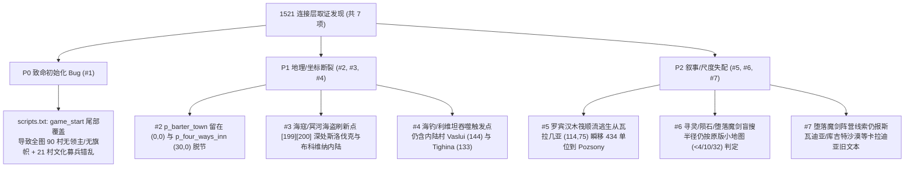

# 阶段 3 深度取证报告：三方基线对齐、场景/海战/事件全链审计与修复方案

审计基准目录：
- **1.011 原版 (`1011`)**：[1011版本体](file:///home/wxm/GOG%20Games/Mount%20Blade%20Warband/game/Modules/Carpathian%20Solid%20%26%20Shade/1011%E7%89%88%E6%9C%AC%E4%BD%93)
- **战团直移基准 (`WB`)**：[SolidAndShadeWB](file:///home/wxm/GOG%20Games/Mount%20Blade%20Warband/game/Modules/SolidAndShadeWB)
- **当前 1521 项目 (`1521`)**：[Carpathian Solid & Shade](file:///home/wxm/GOG%20Games/Mount%20Blade%20Warband/game/Modules/Carpathian%20Solid%20%26%20Shade)

---

## 一、三方版本谱系核实：`1011版本体` 并非最终版，`WB` 零删减

对三套底盘全部 `.txt` 表头与字节码交叉比对后，确认核心谱系事实：

| 指标 | `1011` (`v20.13`) | `WB` (N0ught 后期/终版移植) | `1521` (当前工程) | 结论 |
| :--- | :---: | :---: | :---: | :--- |
| 版本标识 | [Changelog.txt](file:///home/wxm/GOG%20Games/Mount%20Blade%20Warband/game/Modules/Carpathian%20Solid%20%26%20Shade/1011%E7%89%88%E6%9C%AC%E4%BD%93/Changelog.txt#L1) `* Version 20.13 *` | Final S&S 完整版 | 基于 `WB` + 1521 世界层 | **`WB` 比 `1011` 新得多** |
| `parties.txt` | `201` (`0..200`) | `210` (`0..209`) | `210` (`0..209`) | 槽位 100% 对齐 `WB` |
| `party_templates.txt` | `60` | `114` | `114` | 与 `WB` 字节级一致 |
| `scenes.txt` / `.sco` | `418` / `403` | `436` / `432` | `436` / `432` | **与 `WB` 100% MD5 一致** |
| `scene_props.txt` | `751` | `911` | `911` | **与 `WB` 字节级一致** |
| `menus.txt` | `452` | `1312` | `1312` | ID `0..1311` 零偏移 |
| `triggers.txt` | `40` | `180` | `180` | 触发器全量保留 |
| `scripts.txt` | `569` (1.011) | `356` (`0..355`) | `371` (`0..370`) | 尾部追加 `356..370` QoL，零冲突 |
| `troops.txt` / `item_kinds1.txt` | `682` / `740` | `850` / `902` | `850` / `902` | 全槽位零重排 |

> [!IMPORTANT]
> **没有遗漏任何 1.011 原版机制**：从 `1011 (v20.13)` 到 `WB` 唯一移除的是原版 Native 新手训练场 (`training_ground`、`tutorial_1..5`) 和 1 个未引用的废置物件 `spr_Because`。相反，`WB` 完整包含 `v20.13` 之后新增的第六阵营 `fac_kingdom_6` (`The_Unknown` / `[37] p_town_19`)、`scn_museum` (22 幅挂毯秘境导航)、`scn_ivory_temple` (`[208] p_ivorytemple`)、`scn_whalebelly` (利维坦鲸腹)、`pt_riverstyxpirates` (冥河海盗 Akhad Thell)、`pt_kraken`、`scn_cretanlabyrinth`、`scn_nightmarerealm`、`scn_fairyrealm`、`[170] p_barter_town`、`[205] p_sherwood` (罗宾汉支线)、`[207] p_homestead` (Hiraeth) 等全部终版内容。此外，`Khan's Fist` 在终版 S&S 中早已改为血泉黑暗传说合成（`dlga_legendfist_making_1`），不再绑定 `Sanjar_Khan` 掉落。

---

## 二、已验证 100% 完好的核心子系统（无需重做）

1. **场景、秘境交互物与宝箱（100% 字节级一致）**：
   - [scenes.txt](file:///home/wxm/GOG%20Games/Mount%20Blade%20Warband/game/Modules/Carpathian%20Solid%20%26%20Shade/scenes.txt)、[scene_props.txt](file:///home/wxm/GOG%20Games/Mount%20Blade%20Warband/game/Modules/Carpathian%20Solid%20%26%20Shade/scene_props.txt)、[mission_templates.txt](file:///home/wxm/GOG%20Games/Mount%20Blade%20Warband/game/Modules/Carpathian%20Solid%20%26%20Shade/mission_templates.txt)、[party_templates.txt](file:///home/wxm/GOG%20Games/Mount%20Blade%20Warband/game/Modules/Carpathian%20Solid%20%26%20Shade/party_templates.txt)、[quests.txt](file:///home/wxm/GOG%20Games/Mount%20Blade%20Warband/game/Modules/Carpathian%20Solid%20%26%20Shade/quests.txt)、[simple_triggers.txt](file:///home/wxm/GOG%20Games/Mount%20Blade%20Warband/game/Modules/Carpathian%20Solid%20%26%20Shade/simple_triggers.txt)、[map_icons.txt](file:///home/wxm/GOG%20Games/Mount%20Blade%20Warband/game/Modules/Carpathian%20Solid%20%26%20Shade/map_icons.txt) 以及 `SceneObj/*.sco` 全部 `432` 个二进制场景文件与 `WB` **100% MD5 相同**。
   - **Linux 大小写敏感核查**：`SceneObj/` 下 `0` 个大写文件名、`0` 个大小写碰撞重复、`0` 个有效场景缺失（仅 `scn_reserved9..12` 为原版未启用占位符）。
   - **二进制 `.sco` 物件与宝箱核查**：解析博物馆 22 幅挂毯对应场景及 25 个核心秘境 `.sco`（含 `spr_deathstatue`、`spr_ramunskull`、`spr_annabelleetombstone`、`spr_burndoor`、`spr_chest_gothic`、`spr_container_small_chest`、`spr_player_chest` 等），并核验 [scenes.txt](file:///home/wxm/GOG%20Games/Mount%20Blade%20Warband/game/Modules/Carpathian%20Solid%20%26%20Shade/scenes.txt) 中全部 `89` 个宝箱/总管绑定（`trp_zendar_chest = 797`、`trp_bonus_chest_1..27 = 798..824`），**零丢失、零错位**。
2. **大地图连通性（`map.txt` 全网格 BFS 审计）**：
   - 解析 [map.txt](file:///home/wxm/GOG%20Games/Mount%20Blade%20Warband/game/Modules/Carpathian%20Solid%20%26%20Shade/map.txt) 全部 `13,111` 个三角面（其中可通行陆地/浅滩面 `8,157` 个），执行共边连通分量 BFS：主大陆连通分量 `main_comp=1` 包含 `8,099` 个面，**全部实际聚落与秘境锚点（含南端远征点 `[208] p_ivorytemple (60, -435)` 与 `[37] p_town_19 (45, -495)`）100% 位于同一块主大陆网格上**，不存在孤岛死锁或断路。
3. **航海与海怪机制真相**：
   - S&S **没有开放海域玩家乘船航行系统**：`menu_town` 中的 `mno_sail_from_port` 仅在 `$cheat_mode == 1` 且 `slot_party_type == 3` 时可见（Native 废案）；`p_main_party` 的标志位 `0x100000` 是 `pf_limit_members` 而非 `pf_is_ship (0x200000)`；全表 `0` 个队伍模板启用船只标志。
   - **海怪 `pt_kraken (66)`**：使用陆地行军图标 `2`，在 [triggers.txt](file:///home/wxm/GOG%20Games/Mount%20Blade%20Warband/game/Modules/Carpathian%20Solid%20%26%20Shade/triggers.txt#L48-L49) 中当 `$Kraken == 1` 时直接刷在玩家 `0 (p_main_party)` 身边，当末日剧本 `$background_answer_4 == 18` 时刷在黑海港口 `[112] Constanta (271.89, 52.71)` 附近，机制完全正常。

---

## 三、已全量落盘验收的 7 处地理/脚本断裂修复清单（均已备份 `*.bak_stage3`）

> [!NOTE]
> 以下 7 项修复（含 `3x` 盲搜雷达半径放大与罗宾汉密林迁至 `(-272.09, 281.73) Pressburg_Woods / 普雷斯堡密林`）已全部写入工程文件并通过字节码与坐标复核；聚落场景替换的完整红名单与无损迁移 SOP 已独立成册于 [settlement_scene_migration_guide.md](file:///home/wxm/.gemini/antigravity/brain/bd205a2a-4507-45aa-b018-901a2066a38e/settlement_scene_migration_guide.md)。

### Bug #1 [P0 / 致命]：`game_start` 尾部追加村庄绑定导致全图 90 村无领主 + 21 村文化/募兵/集市错乱
- **定位**：[scripts.txt](file:///home/wxm/GOG%20Games/Mount%20Blade%20Warband/game/Modules/Carpathian%20Solid%20%26%20Shade/scripts.txt#L3-L4) 中 `game_start` 的 `op#1167..1346`（共 `180` 条指令，`90` 组 `party_set_slot(village, 120, bound_center)` + `call_script(give_center_to_faction_aux, village, faction)`）。
- **根因**：这 `180` 条重绑定指令被追加在 `game_start` **最末尾**，晚于：
  - `op#931..936`：写入 `slot_center_culture (19)` 与 `slot_center_original_faction (61)`；
  - `op#938`：`update_village_market_towns`；
  - `op#1140`：`assign_lords_to_empty_centers`（给城镇/城堡及下辖村分封领主与旗帜）；
  - `op#1148`：`update_volunteer_troops_in_village`（生成开局志愿兵）；
  - `op#1159`：`update_center_notes`（百科归属记录）。
  更致命的是，[give_center_to_faction_aux](file:///home/wxm/GOG%20Games/Mount%20Blade%20Warband/game/Modules/Carpathian%20Solid%20%26%20Shade/scripts.txt#L213-L214)（`script 105` 的 `op#13..14`）内部执行了 `party_set_slot(center, slot_town_lord=7, -1)` 和 `party_set_banner_icon(center, 0)`！
- **后果**：
  1. 开新档第 1 天，**全图 90 个村庄的领主全部被洗成 `-1`（无领主野村），大地图村庄旗帜全部清零**；
  2. **21/90 个改换门庭的村庄**（如 `[83] Razgrad`、`[87] Szombathely`、`[102] Gacko`、`[104] Prijepolje`、`[105] Srebrenica`、`[109] Targu_Jiu`、`[112] Constanta`、`[124] Varazdin`、`[133] Tighina`、`[148] Kladovo`、`[153] Nikopol`、`[158] Mangalia` 等）保留了旧阵营的 `slot_center_culture`、旧原始阵营、错误的贸易母城和错误的募兵兵种！
- **修复**：将 `game_start` 的 `op#1167..1346`（`180` 条指令）整体前移插到 `op#931` 之前（紧接自动就近绑定循环 `op#896..930` 结束之后），指令总数 `1347` 不变（已验证 90 村手动 `faction` 与其 `bound_center` 所属阵营 `0` 冲突）。

### Bug #2 [P1 / 高危]：末日剧本 `[170] p_barter_town` 与 `[169] p_four_ways_inn` 坐标脱节
- **定位**：[parties.txt](file:///home/wxm/GOG%20Games/Mount%20Blade%20Warband/game/Modules/Carpathian%20Solid%20%26%20Shade/parties.txt#L341-L343) 与 [menus.txt](file:///home/wxm/GOG%20Games/Mount%20Blade%20Warband/game/Modules/Carpathian%20Solid%20%26%20Shade/menus.txt#L37) (`menu_choose_skill2` `op#1405..1417`)。
- **根因**：选择末日剧本（`$background_answer_4 == 18`）时，脚本将玩家传送至 `[169] p_four_ways_inn (30.0, 0.0)`，隐藏 `169` 并原地启用废土市集 `[170] p_barter_town`。`1521` 把 `169` 移到了 `(30.0, 0.0)`，却把 `170` 忘在了 `(0.0, 0.0)`，导致开局市集偏离玩家 `30` 单位。
- **修复**：将 [parties.txt](file:///home/wxm/GOG%20Games/Mount%20Blade%20Warband/game/Modules/Carpathian%20Solid%20%26%20Shade/parties.txt#L343) 中 `[170] p_barter_town` 的三组坐标同步设为 `30.000000 0.000000`。

### Bug #3 [P1 / 高危]：海寇与冥河海盗（Akhad Thell）刷新在深山内陆
- **定位**：[parties.txt](file:///home/wxm/GOG%20Games/Mount%20Blade%20Warband/game/Modules/Carpathian%20Solid%20%26%20Shade/parties.txt#L401-L403)（`[199] p_sea_raider_spawn_point_1`、`[200] p_sea_raider_spawn_point_2`），被 [scripts.txt](file:///home/wxm/GOG%20Games/Mount%20Blade%20Warband/game/Modules/Carpathian%20Solid%20%26%20Shade/scripts.txt#L571) (`spawn_bandits`：`pt_sea_raiders = 40` 与 `pt_riverstyxpirates = 41`) 及开局海岸出生点 `menu_choose_skill2` (`op#863..866`) 调用。
- **根因**：沿用了卡拉迪亚坐标简单 `3x` 放大值：`[199] (-129.0, 288.0)` 落在斯洛伐克北部内陆山地（距海 `210.4`），`[200] (141.0, 258.0)` 落在摩尔达维亚/布科维纳内陆（距海 `75.2`）。
- **修复**：移至 `map.txt` 主大陆 `main_comp=1` 与海域直接共边的海岸陆地三角面重心：
  - `[199] p_sea_raider_spawn_point_1` -> **黑海多布罗加/瓦尔纳海岸** `(275.850000, 8.060000)`（`face#3688`，`terr=3`）；
  - `[200] p_sea_raider_spawn_point_2` -> **爱琴海色雷斯海岸** `(121.920000, -256.280000)`（`face#1971`，`terr=1`；或亚得里亚海岸 `(-295.74, -59.09)`）。

### Bug #4 [P1 / 高危]：海钓 / 利维坦巨鲸吞噬触发点残留 2 个内陆村庄
- **定位**：[triggers.txt](file:///home/wxm/GOG%20Games/Mount%20Blade%20Warband/game/Modules/Carpathian%20Solid%20%26%20Shade/triggers.txt#L57-L60)（海钓触发器 `L58` 与脱离判定 `L60`）。
- **根因**：在特定 5 个村庄半径 `< 1` 扎营会激活海钓（1% 概率被利维坦拖入海底进入 `scn_whalebelly`，脱困后吐在黑海 `[112] Constanta`）。阶段 2 已将 `143 -> 160 (Babadag)`、`113 -> 118 (Gelibolu_Gallipoli)`，但剩余两个槽位 `[144] Vaslui (216.06, 218.97)`（摩尔达维亚腹地，距海岸线 `111.2`）与 `[133] Tighina (292.71, 238.49)`（德涅斯特河中游内陆，距海 `42.4`）仍为内陆村。
- **修复**：在 [triggers.txt](file:///home/wxm/GOG%20Games/Mount%20Blade%20Warband/game/Modules/Carpathian%20Solid%20%26%20Shade/triggers.txt#L57-L60) 中将 `144 -> 125`（马尔马拉海港 [Rodoscuk](file:///home/wxm/GOG%20Games/Mount%20Blade%20Warband/game/Modules/Carpathian%20Solid%20%26%20Shade/parties.txt#L253)，距海 `7.01`）、`133 -> 158`（黑海港 [Mangalia](file:///home/wxm/GOG%20Games/Mount%20Blade%20Warband/game/Modules/Carpathian%20Solid%20%26%20Shade/parties.txt#L319)，距海 `21.60`），形成纯正五大海港：`158 Mangalia`、`112 Constanta`、`160 Babadag`、`125 Rodoscuk`、`118 Gelibolu_Gallipoli`。

### Bug #5 [P2 / 中高]：罗宾汉木筏逃生 `[205] Wallachian_Forest` -> `[81] Pozsony` 跨图瞬移 433.6 单位
- **定位**：[parties.txt](file:///home/wxm/GOG%20Games/Mount%20Blade%20Warband/game/Modules/Carpathian%20Solid%20%26%20Shade/parties.txt#L413-L415)、`menu_boatsuccess` / `menu_boatcapsize` / `menu_boatcircesaves` / `menu_robinwin`、[mission_templates.txt](file:///home/wxm/GOG%20Games/Mount%20Blade%20Warband/game/Modules/Carpathian%20Solid%20%26%20Shade/mission_templates.txt#L861) 及村长烧毁庄园对话（锁死 `eq(:loc0, 81)`）。
- **根因**：原版 `[205] Usherwood (-12, 23)` 紧邻 `[81] Nomar (-14.6, 17.5)` 上游仅 `6.1` 单位，剧情描写乘木筏顺河漂流几里抵达 `81`。而 `1521` 将 `[205] p_sherwood` 与 `[206] p_sherwood2` 放在瓦拉几亚 `(114.0, 75.0)`，但保留了 `[81] Pozsony (-265.30, 283.44)` 的全部传送与村长对话绑定，一划船就逆多瑙河瞬移 `433.6` 单位到匈牙利西北边境。
- **修复选项**：
  - **方案 A（推荐，零字节码/零场景侵入）**：保持原版 `81` 绑定不动，将 `[205] p_sherwood` 与 `[206] p_sherwood2` 移至 `[81] Pozsony` 上游小喀尔巴阡/多瑙河岸可通行三角面 `(-272.090000, 281.730000)`（`face#5428`，距 `Pozsony` `7.0` 单位）或林地面 `(-243.210000, 259.270000)`（`face#5332` `terr=11`，距 `Pozsony` `32.7` 单位），并将 `Wallachian_Forest` / `瓦拉几亚森林` 改名为 `Pressburg_Woods` / `普雷斯堡林地`。
  - **方案 B**：保留瓦拉几亚森林 `(114.0, 75.0)` 不动，接受木筏漂流回 `Pozsony` 的远距传送（不推荐改绑 `81` 到瓦拉几亚村庄，因 `scn_village_4` 专属烧毁庄园场景与对话强耦合在 `81` 槽位上）。

### Bug #6 [P2 / 中高]：三大秘境盲搜罗盘半径未随 1521 大地图（面积 ~16 倍）缩放
- **定位**：[menus.txt](file:///home/wxm/GOG%20Games/Mount%20Blade%20Warband/game/Modules/Carpathian%20Solid%20%26%20Shade/menus.txt#L53) (`menu_camp`) 与 [menus.txt](file:///home/wxm/GOG%20Games/Mount%20Blade%20Warband/game/Modules/Carpathian%20Solid%20%26%20Shade/menus.txt#L2505-L2519) (`menu_spirit_center_*`)。
- **根因**：通灵板/灵异相机（`$spiritposition`，随机全图 90 村之一）、星盘寻绿陨石（`$meteorposition`，随机 90 村之一）、黑男爵寻堕落魔剑（`$fallenswordposition`，随机 40 堡之一）仍使用卡拉迪亚 `210x210` 小地图阈值：`< 4` 触发发现、`4..10` 强烈感应、`10..32` 微弱发光/阵营提示（在 `710x1015` 的 1521 地图上，半径 `32` 仅占全图面积的 **0.44%**！），且 `menu_spirit_center_*` 内连续重测选项 `mno_another` 甚至缩半为 `< 2 / 2..5 / 5..17`，玩家在全图盲找几乎不可能碰上感应圈。
- **修复**：按地图线性比例 `3x` 同步放大这两组距离判定阈值至 **`< 12`（发现）/ `12..30`（强烈）/ `30..96`（微弱/阵营提示）**，并统一 `mno_another` 与首次扎营探测半径一致。（注：[triggers.txt](file:///home/wxm/GOG%20Games/Mount%20Blade%20Warband/game/Modules/Carpathian%20Solid%20%26%20Shade/triggers.txt#L51) 的城堡采草药 `< 3` 因任务文本已点名具体 3 座城堡，贴脸触发正常，无需放大。）

### Bug #7 [P2 / 中]：堕落魔剑阵营线索仍报卡拉迪亚五国风貌 + 残余旧名清单
- **定位**：[menus.txt](file:///home/wxm/GOG%20Games/Mount%20Blade%20Warband/game/Modules/Carpathian%20Solid%20%26%20Shade/menus.txt#L2523-L2531) (`menu_fallen_culture1..5`) 与 [game_menus.csv](file:///home/wxm/GOG%20Games/Mount%20Blade%20Warband/game/Modules/Carpathian%20Solid%20%26%20Shade/languages/cns/game_menus.csv#L1072-L1076)。
- **根因**：当黑男爵感应到 `$fallenfaction`（`15..19`）时，文本仍提示去搜寻 *"Swadian / Vaegir / arid desert Khergit / stormy coastal Nord / Rhodok lands"*（如 `$fallenfaction == 17` 奥斯曼帝国却提示去“干旱沙漠库吉特领地”，`$fallenfaction == 18` 瓦拉几亚公国却提示去“风暴海岸诺德领地”），直接误导玩家找错国家！
- **修复**：将 `menu_fallen_culture1..5` 的中英文提示精确重写为 1521 五国地理特征：
  - `culture1 (15)` -> **匈牙利王国 (`Kingdom of Hungary`)**（潘诺尼亚平原与多瑙河流域）
  - `culture2 (16)` -> **摩尔达维亚公国 (`Principality of Moldavia`)**（东喀尔巴阡山林与普鲁特河谷）
  - `culture3 (17)` -> **奥斯曼帝国 (`Ottoman Empire`)**（巴尔干南疆、色雷斯与安纳托利亚）
  - `culture4 (18)` -> **瓦拉几亚公国 (`Principality of Wallachia`)**（南喀尔巴阡山麓与多瑙河下游平原）
  - `culture5 (19)` -> **克罗地亚王国 (`Kingdom of Croatia`)**（迪纳拉山脉与亚得里亚海岸）

> [!TIP]
> **附：非功能性残余旧名盘点（不影响玩法触发，可按需决定是否后续汉化润色）**
> 1. 复国者称谓残留：`Prince_Valdym_the_Bastard`、`Dustum_Khan`、`Lethwin_Far-Seeker`，以及 `Lady_Isolla` / `Lord_Kastor` 英文前缀；
> 2. 常规兵种树与装备前缀：`troops.txt` 中 `Swadian_* / Vaegir_* / Khergit_* / Rhodok_*` 普通兵种名，`item_kinds1.txt` 中 `Khergit_*` 弓箭马匹名；
> 3. 背景叙事字符串：`languages/cns/*.csv` 中约 `144` 处 `卡拉迪亚`（英文表 `4` 处 `Calradia`）。

---

## 四、后续全量换场景 / 换五大国兵种领主 / 清装备的防破坏红名单

**核心结论**：只要聚落槽位 ID（`p_town_1..18`、`p_castle_1..40`、`p_village_1..90`）、大地图坐标与归属不变，你后续替换聚落场景和五大国兵种装备**完全不会推翻阶段 1–3 的修复成果**。但因为 `SolidAndShadeWB` 字节码采用**无标签裸整数行号**寻址，且 N0ught 在部分常规聚落场景中埋设了暗门/彩蛋宝箱，后续施工必须遵守以下三条红线：

### 1. 聚落场景替换红名单（360+ 常规子场景中仅 31 个含 S&S 秘境机关）
其余 **91% 的常规城镇/城堡/村庄场景**（如 40 座城堡中的 37 座、90 个村庄中的 76 个）完全不含 S&S 物件，可直接覆盖 `.sco` 与 [scenes.txt](file:///home/wxm/GOG%20Games/Mount%20Blade%20Warband/game/Modules/Carpathian%20Solid%20%26%20Shade/scenes.txt) 地形码。**唯独以下 31 个子场景若要替换 `.sco`，必须在 `Ctrl+E` 编辑模式补回对应 `spr_*` 机关物件，并在 [scenes.txt](file:///home/wxm/GOG%20Games/Mount%20Blade%20Warband/game/Modules/Carpathian%20Solid%20%26%20Shade/scenes.txt) 第 3 行保留 `trp_bonus_chest_*`**：

| 类别 | 场景 ID (`SceneObj/*.sco`) | 内含 S&S 专属物件 / 宝箱 / 脚本挂钩 | 破坏后果 |
| :--- | :--- | :--- | :--- |
| **城镇 (14)** | `scn_town_1_tavern` / `_store` / `_arena` | [mission_templates.txt](file:///home/wxm/GOG%20Games/Mount%20Blade%20Warband/game/Modules/Carpathian%20Solid%20%26%20Shade/mission_templates.txt) `store_current_scene` 刷特殊事件/人物（保持标准出生点 `entry 0..32` 即可） | 特定场景触发器异常 |
| | `scn_town_2_center` / `scn_town_2_tavern` | `center` 含宝箱容器 + `trp_bonus_chest_3`；`tavern` 含场景判定 | 丢失隐藏神器宝箱 #3 |
| | `scn_town_3_store` | `spr_caskofamontillado`、`spr_humanskull`、暗门 `spr_thirteen` + `trp_bonus_chest_4` | 断绝《一桶白葡萄酒》秘境与宝箱 #4 |
| | `scn_town_5_center` | 宝箱容器 + `trp_bonus_chest_2` | 丢失隐藏神器宝箱 #2 |
| | `scn_town_6_prison` | `spr_montresor`、暗门 `spr_thirteen`（通往 `scn_town_6_catacombs` / `trp_bonus_chest_26`） | **断绝地下墓穴入口** |
| | `scn_town_9_tavern` | 暗门 `spr_thirteen`（通往 `scn_town_9_basement` / `trp_bonus_chest_5`） | **断绝酒馆地下室入口** |
| | `scn_town_11_center` | `mission_templates.txt` 场景判定（保持标准出生点即可） | 特定事件不触发 |
| | `scn_town_13_center` | 宝箱容器 + `trp_bonus_chest_1` | 丢失隐藏神器宝箱 #1 |
| | `scn_town_14_castle` | 暗门 `spr_thirteen`（通往 `scn_town_14_reliquary` 与特斯拉实验室 `_nikola` / `trp_bonus_chest_8`） | **断绝圣物室与特斯拉支线** |
| | `scn_town_17_tavern` | `spr_purloinedletter`、暗门 `spr_thirteen` + `trp_bonus_chest_6` | 断绝《失窃的信》与宝箱 #6 |
| | `scn_town_18_center` | `spr_VenusDeMilo`（断臂维纳斯雕像）+ 场景判定 | 丢失博物馆挂毯地标 |
| **要塞 (3)** | `scn_castle_12_prison` | [conversation.txt](file:///home/wxm/GOG%20Games/Mount%20Blade%20Warband/game/Modules/Carpathian%20Solid%20%26%20Shade/conversation.txt) 牢房场景判定（保持标准地牢出生点即可） | 特定囚犯对话失效 |
| | `scn_castle_15_exterior` | `spr_MarblePillar`、`spr_humanskull`、`spr_snakedummy` | 丢失蛇神遗迹交互物 |
| | `scn_castle_23_exterior` | `spr_Catapult` | 丢失投石机彩蛋物件 |
| **村庄 (14)** | `scn_village_4` (`[81] Pozsony`) | `spr_sheriffarrow` + `trp_bonus_chest_23`（且勿删独立子场景 `scn_village_4_usherwood` / `_mansion`） | 丢失罗宾汉后续彩蛋与宝箱 #23 |
| | `scn_village_20` | `spr_ArmchairShade`、`spr_ChessTower` | **丢失国际象棋塔秘境 #1** |
| | `scn_village_25` | `spr_obelisk` | 丢失方尖碑秘境 |
| | `scn_village_31` | `spr_hut` + 场景判定 | 丢失林中小屋秘境 |
| | `scn_village_35` (`[112] Constanta`) | `spr_KnightTower`、`spr_poseidonruins`、`spr_strangeshell` + `trp_bonus_chest_10` | **丢失波塞冬遗迹、骑士塔与奇异海螺** |
| | `scn_village_41` (`[118] Gelibolu`) | `spr_MarblePillar`、`spr_filthcorpse` + 对话判定 | 丢失污秽尸骸支线点 |
| | `scn_village_48` (`[125] Rodoscuk`) | `spr_Ferryboat`、`spr_UnderworldGate`、`spr_undeaddummy` | **丢失冥河渡船与冥界之门** |
| | `scn_village_56` (`[133] Tighina`) | `spr_BishopTower`、`spr_goldbug`、暗门 `spr_thirteen` + `trp_bonus_chest_7` | **丢失主教塔、《金甲虫》与宝箱 #7** |
| | `scn_village_61` / `scn_village_75` | `mission_templates.txt` 场景判定（保持标准出生点即可） | 特定村庄触发器失效 |
| | `scn_village_66` (`[143] Chilia_Veche`) | `spr_annabelleetombstone` + `trp_bonus_chest_13` | **丢失安娜贝尔·李海边墓碑与宝箱 #13** |
| | `scn_village_67` (`[144] Vaslui`) | `spr_humanskull` + 场景判定（且勿删 `scn_village_67_cave`） | 丢失骷髅洞穴线索 |
| | `scn_village_84` (`[161] Tulcea`) | `spr_cocoon`、暗门 `spr_thirteen` + `trp_bonus_chest_11` | **丢失虫茧秘境与宝箱 #11** |
| | `scn_village_88` (`[165] Orhei`) | `spr_gorgonruins` | 丢失戈耳工美杜莎遗迹 |

*(另：请勿删除 [scenes.txt](file:///home/wxm/GOG%20Games/Mount%20Blade%20Warband/game/Modules/Carpathian%20Solid%20%26%20Shade/scenes.txt) 序号 `409..435` 的所有独立秘境场景及 `scn_town_19_*` 亡灵城场景。后续你换好新 `.sco` 后，我也可以直接写二进制脚本把上述 `spr_*` 机关坐标迁移注入到新 `.sco` 中。)*

### 2. 五大国领主与兵种树替换铁律（[troops.txt](file:///home/wxm/GOG%20Games/Mount%20Blade%20Warband/game/Modules/Carpathian%20Solid%20%26%20Shade/troops.txt)）
- **好消息**：全表扫描确认，S&S 的亡灵/剧情文件（`menus.txt`、`triggers.txt`、`conversation.txt`、`mission_templates.txt`）对五大国常规士兵槽（`184..247`）和五大国君主/领主槽（`358..463`）**是 `0` 硬编码引用**！
- **唯一铁律——严禁在行号 `0..849` 中间插入或删除任何一行**：因为 S&S 自定义兵种分布在 `2..183`（亡灵/Boss/罗宾汉等），隐藏宝箱容兵分布在 `797..824`（`trp_zendar_chest`、`trp_bonus_chest_1..27`）。中间删/插 1 行会导致后面所有 S&S 兵种与宝箱 ID 整体错位！
- **正确做法**：在 `184..247`、`358..463` 原位修改属性/装备/升级树；超出 `64` 个兵种槽的新增兵种**一律追加在文件末尾（行号 `>= 850`）**，再同步更新 `party_templates.txt` 的 `pt_kingdom_1..5_reinforcements_a/b/c` 与 `scripts.txt` 的阵营募兵槽位。

### 3. 原版装备清理与替换铁律（[item_kinds1.txt](file:///home/wxm/GOG%20Games/Mount%20Blade%20Warband/game/Modules/Carpathian%20Solid%20%26%20Shade/item_kinds1.txt)）
- **高危暗雷**：在 `0..901` 范围内，除了 S&S 专属书籍/尸体/器官/神器（`56..176`、`600..901`），**还有 166 件原版 Native 物品（分布在 `1..446`，包括屠刀 `itm_butchering_knife`、镰刀、短斧、木棍、铁锤、各类食物贸易品、马匹及部分基础武器护甲）被 S&S 的死灵合成、解剖、伪装、机关制作菜单按裸整数 ID 直接调用！**
- **正确做法**：
  1. **严禁删除 `0..901` 中的任何一行物品**，也不要把 `1..446` 的原版物品改造成毫不相干的装备；
  2. 如果不想让原版装备出现在 1521 商店里，只需取消该装备 flags 中的商店售卖标志位 **`itp_merchandise` (`0x0000000001000000`)**（注意保留工具、食物、贸易品和基础马匹的商品标志，否则死灵解剖/合成会买不到材料）；
  3. 所有新增 1521 历史武器盔甲**一律追加在文件最末尾（行号 `>= 902`）**。

