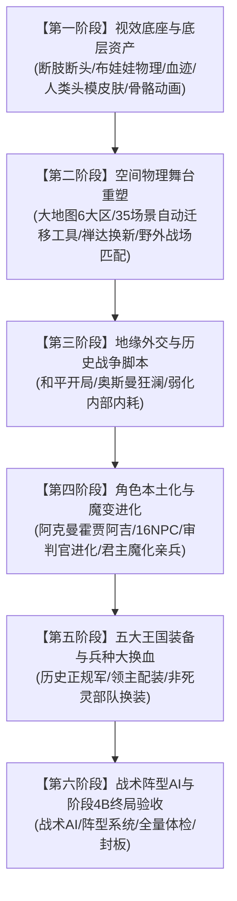

# Carpathian Solid & Shade (1521) — 阶段 4B 前置工程全量总蓝图与实施执行计划书

**文档版本**：v1.0  
**基线提交**：`5379e3e`（修复 `menu_reports` 与 `menu_camp` 大地图无堆栈返回 bug）  
**护栏状态**：`tools/overhaul_guard.py` 严格验证通过（0 槽位漂移 / 0 生命线断供 / 0 字节码越界）  
**适用范围**：阶段 4A（基线护栏确立与场景查看器 3.0）至阶段 4B（全量历史大换血与大一统封板）之间的所有开发立项  

---

## 目录
1. [基线状态与工程约束](#1-基线状态与工程约束)
2. [六阶段执行次序与工程依赖链](#2-六阶段执行次序与工程依赖链)
3. [各阶段详细技术实施方案](#3-各阶段详细技术实施方案)
   - [第一阶段：视效底座与断肢布娃娃物理](#第一阶段视效底座与断肢布娃娃物理)
   - [第二阶段：大地图地貌重塑与场景自动化迁移](#第二阶段大地图地貌重塑与场景自动化迁移)
   - [第三阶段：地缘外交与 1521 历史征伐演进](#第三阶段地缘外交与-1521-历史征伐演进)
   - [第四阶段：人物本土化、魔变亲兵与白袍审判官](#第四阶段人物本土化魔变亲兵与白袍审判官)
   - [第五阶段：五大王国装备与兵种大换血](#第五阶段五大王国装备与兵种大换血)
   - [第六阶段：战术阵型 AI 与阶段 4B 终局验收](#第六阶段战术阵型-ai-与阶段-4b-终局验收)
4. [核心疑难实机逆向查验记录](#4-核心疑难实机逆向查验记录)
   - [A. 原版 34 位 NPC 身份全景清单](#a-原版-34-位-npc-身份全景清单)
   - [B. BloodGoryandFlamere_WB 断肢断头与布娃娃物理底层解构](#b-bloodgoryandflamere_wb-断肢断头与布娃娃物理底层解构)
   - [C. 禅达城（旧曾扎尔 scn_zendar_center）核心实体拓扑](#c-禅达城旧曾扎尔-scn_zendar_center核心实体拓扑)
   - [D. 三大黑化君主亲兵魔变机制补全](#d-三大黑化君主亲兵魔变机制补全)

---

## 1. 基线状态与工程约束

当前模块已完成前三阶段历史化迁移与阶段 4A 护栏加固，核心数据指标如下：

- **物品总数（`item_kinds1.txt`）**：902 件（基线 902，0 漂移，64 件 S&S 关键道具处于在售保护）。
- **兵种总数（`troops.txt`）**：850 位（基线 850，0 漂移；`trp_kingdom_6_lord` 位于 363，21 位死骑领主位于 464..484）。
- **队伍模板（`party_templates.txt`）**：114 组（基线 114，0 漂移；亡灵第六国 a..f 增援模板位于 108..113）。
- **场景总数（`scenes.txt`）**：436 个场景；全局变量 1298 个。
- **场景查看器**：v3.0 已全面实装，涵盖 8 大类 45 个子菜单，支持实机一键巡查 35 个红名单聚落与地下秘境。

### 核心铁律
1. **绝对零漂移**：任何新模型、新装备、新兵种只在现有预留槽位中换皮，或安全追加至表尾，严禁插入中间破坏静态 ID。
2. **亡灵系统物理隔离**：五大王国、人类 NPC、捕奴队与战场视效改造不得动摇 S&S 核心死灵黑魔法与异次元系统。
3. **每次里程碑必归档**：每完成一个独立阶段，必须运行 `overhaul_guard.py` 体检并推送 GitHub。

---

## 2. 六阶段执行次序与工程依赖链

为了避免反复修改相同文件造成的数据磨损与开发摩擦，各立项的执行严格遵循以下依赖拓扑：

### 排序逻辑
1. **视效先行**：先将头模、皮肤贴图、断肢网格和动作库装配好，后续给新兵种配装时便能直接引用新模型，避免多次回炉修改 `troops.txt`。
2. **物理舞台先行**：大地图 6 大地貌和城镇场景换好后，野外战场的地形映射才能精准对位，且场景查看器可实时核验。
3. **宏观政治先行**：先通过外交规则把列国交战节奏稳定住（奥斯曼与匈牙利死磕，抑制四国内乱）。
4. **角色与神话机制先行**：在配平全军兵种之前，先把黑化三大君主、亲兵魔变、白袍审判官和阿克曼霍贾·阿吉这套骨干机制跑通。
5. **军队全面换血**：此时资产齐备、政治清晰、剧情稳固，大批量换装 5 国兵种树。
6. **战术赋能与封板**：最终赋予战术与阵型 AI，完成 4B 验收。

---

## 3. 各阶段详细技术实施方案

### 【第一阶段】视效底座与断肢布娃娃物理

#### 1. 移植 `BloodGoryandFlamere_WB` 断肢断头与布娃娃物理
- **资源层**：
  - 复制 `body_meshes.brf`（含 `undead_body`、断颈网格）、`blood.brf`（血雾喷射）、`bloodscreen.brf`（受击溅血）。
  - 复制 6 张血迹粒子贴图（`prt_text_blood_*.dds`、`bloodscreen.dds`）。
  - 在 `module.ini` 中引入 `load_mod_resource`。
- **物理与布娃娃层**：
  - 在 `module.ini` 中启用 `sync_ragdoll_effects = 1`。
  - 接入动态尸体倒地与布娃娃物理计算。
- **道具与粒子层**：
  - 在 `particle_systems.txt` 尾部追加 `psys_blood_decapitation`（高压喷颈血）。
  - 在 `scene_props.txt` 尾部追加动态飞头实体：`spr_head_dynamic_male` 与 `spr_head_dynamic_female`。
- **触发器层**：
  - 在 `mission_templates.txt` 的核心战斗模板中植入 `ti_on_agent_killed_or_knocked_out`（-28）斩击判定逻辑。当致命伤为头部斩击（切击伤害 > 25）时，隐藏死者头部并生成飞头道具、断颈截面与喷血粒子。
- **S&S 亡灵豁免**：增加种族判定，骨架型亡灵（骷髅）免除人体断颈模型，改用散架骨渣粒子。

#### 2. 人类头模与多文化皮肤重构
- 导入高清脸模与眼鼻骨骼贴图。
- 在 `skins.txt` 中扩展人种文化面孔库：
  - 匈牙利/波兰：中欧日耳曼-西斯拉夫面孔
  - 奥斯曼帝国：突厥-安纳托利亚面孔
  - 瓦拉几亚/摩尔达维亚：达契亚-巴尔干面孔
  - 南斯拉夫各族：巴尔干南部斯拉夫面孔

#### 3. 动作库与骨骼动画更替
- 导入战斗动作库（`actions.txt` 与动画 BRF），支持断头抽搐死亡动作（`act_death_decapitation`）与更具打击感的攻击硬直。

---

### 【第二阶段】大地图地貌重塑与场景自动化迁移

#### 1. 大地图 6 大地貌雕琢（`map.txt`）
按历史地理精准划分 6 大区域，调整网格高度与地表贴图（草地、干旱、丘陵、山脉、沼泽、雪地）：
1. **匈牙利平原与多瑙河中游**：低海拔起伏平原、冲积草甸、多瑙河主干水系。
2. **特兰西瓦尼亚与喀尔巴阡山地**：高耸锯齿状山脉、茂密针叶林、狭窄山间盆地与关隘。
3. **瓦拉几亚与多瑙河下游北岸**：多瑙河冲积平原、茂密低地沼泽与森林。
4. **摩尔达维亚与黑海北部**：起伏丘陵向黑海北岸德涅斯特河与草原过渡。
5. **巴尔干内陆（波斯尼亚/塞尔维亚/保加利亚）**：复杂喀斯特岩溶地貌、险峻峡谷山岭。
6. **克罗地亚/达尔马提亚/亚得里亚海**：陡峭沿海山脉、地中海灌木岩岸与海湾。

#### 2. 研发自动化场景锚点迁移脚本（`tools/sco_anchor_transplanter.py`）
- 依据 Swyter 逆向的 `.sco` 二进制规范，自动读取原版 35 个红名单场景，提取所有的：
  - `spr_secret_door`（暗门）
  - `spr_graverobbing_grave`（盗墓墓穴）
  - `spr_barrel_amontillado`（阿蒙蒂亚度酒桶）
  - 特殊机制 Entry Point（如 13 号密室点、20 号地牢点）。
- 覆盖新场景时，脚本自动把这些实体注入新 `.sco`，并自动计算新场景地形高程（Heightmap）贴地吸附，彻底省去手动查 ID 重新搭建的繁琐操作。

#### 3. 禅达城（旧曾扎尔）换新场景
- 为旧曾扎尔更换具备喀尔巴阡古代遗迹风貌的高清场景。
- 注入 `spr_bloodfountain`（血泉本体）、`spr_container_chest_c`（献祭箱）及 Entry 0~12，确保哈迪斯预言、血泉献祭与剧情推进 100% 完整。

#### 4. 剩余 90% 常规聚落场景迁移与野外战场匹配
- 批量替换城镇街道、城堡领主大厅、监狱与村庄外景。
- 在 `scenes.txt` 中依据 6 大地貌配置对应的野外遭遇战场景。

---

### 【第三阶段】地缘外交与 1521 历史征伐演进

#### 1. 阵营关系回归和平开局
- 将 `factions.txt` 中五大王国的互相关系由目前的负数开战状态恢复为 `0.00`（原版 S&S 的开局和平基准），解除全图乱战。

#### 2. 1521 喀尔巴阡-巴尔干历史战争脚本
- **奥斯曼帝国前线死敌**：
  - 锁定奥斯曼（Kingdom 3）与匈牙利（Kingdom 1）的死敌关系，历史重现苏莱曼大帝北伐进攻贝尔格莱德战役。
  - 在 `scripts.txt` 的外交判定中提高奥斯曼对多瑙河防线的宣战权重。
- **弱化四国内耗**：
  - 降低匈牙利、波兰、摩尔达维亚与瓦拉几亚之间的宣战概率，突出其面对异教徒入侵的同盟抵御态势与朝贡纳税摇摆，避免人类阵营过早崩溃。

---

### 【第四阶段】人物本土化、魔变亲兵与白袍审判官

#### 1. NPC 本土化改名与调配
- **拉蒙迁址与改名**：
  - 在 `scripts.txt`（`update_ransom_brokers`）中将拉蒙的目标城池由 20 改为 31（阿克曼/白堡酒馆）。
  - 在 `menu_ramundead` 中同步更新清除槽位。
  - 汉化文件更名为**“霍贾·阿吉”**。
- **罗宾汉改名范海辛**：
  - 将原版罗宾汉更名为范海辛，并在其场景中配发银质圣桩与伏魔弩。
- **16 位 Native 酒馆伴侣全面改造**：
  - `trp_npc1` ~ `trp_npc16` 依照 1521 历史人物全量重做（名字、属性、装备、对话文本）。
  - 保留 `trp_npc17` ~ `trp_npc34`（爱伦坡、杜宾、拉斯普京等 18 位 S&S 神秘学伴侣）。

#### 2. 奴隶猎手动态魔化为白袍审判官/猎魔人
- 在 `simple_triggers.txt` 中监控全图死灵威胁度或天数。
- 达标后，将野外巡逻的捕奴队模板定向升级为教会圣堂审判官军团（配置白袍罩甲、银剑、驱魔十字弩），锁定优先追击野外亡灵与玩家黑暗部队。

#### 3. 三大黑化君主神话重塑与亲兵卫队魔变
- **黑化对象重定位**：
  - 瓦拉几亚大公（361） -> 德古拉吸血鬼大公（配发吸血鬼神兵套 `itm_vampire_*`，模型设为不死族）
  - 摩尔达维亚大公（359） -> 喀尔巴阡狼人始祖（配发狼人利爪套 `itm_wolf*`，模型设为狼人）
  - 匈牙利国王（358） -> 堕落黑暗反英雄（配发暗黑神兵套 `itm_black_*`）
- **亲兵卫队魔变机制（弥补原版缺陷）**：
  - 在天启爆发脚本（`mno_necropoliscontinue` 与 `menu_player_earns_antihero`）中，清空三大君主队内原有人类杂兵。
  - 强制注入高阶怪物精锐：
    - 瓦拉几亚大公卫队：吸血鬼亲卫、鲜血侍从、食尸鬼群。
    - 摩尔达维亚大公卫队：变异狼人、凶暴狼群、狂暴战熊。
    - 匈牙利国王卫队：暗黑骑士、暗黑复仇圣堂死士。

---

### 【第五阶段】五大王国装备与兵种大换血

- **匈牙利王国**：黑军精锐、骠骑轻骑兵、多瑙长矛方阵、链甲重骑兵。
- **奥斯曼帝国**：加尼沙里苏丹亲兵、西帕希重骑兵、阿金奇散兵、巴什波祖克。
- **波兰王国**：早期翼骑兵、海杜克火绳枪手、随从骑士、哥萨克轻骑。
- **瓦拉几亚公国**：博亚尔贵族骑兵、长矛民兵、瓦拉几亚轻骑弓手。
- **摩尔达维亚公国**：喀尔巴阡长弓手、库尔泰轻骑勇士、山地重装步兵。
- **全程使用 `overhaul_guard.py` 巡检，锁定 902 物品与 850 兵种槽位。**

---

### 【第六阶段】战术阵型 AI 与阶段 4B 终局验收

1. 植入强化战术 AI 与阵型系统（骑兵两翼包抄、步兵推进防冲、弓弩交替射击）。
2. 使用场景查看器 v3.0 巡查 35 个红名单聚落与新禅达城。
3. 检查三大君主天启魔变与全图战场断肢血迹表现。
4. 全量封板，打上阶段 4B Git Release 标签。

---

## 4. 核心疑难实机逆向查验记录

### A. 原版 34 位 NPC 身份全景清单

| 索引范围 | 数量 | 类别 | 处理策略 |
| :--- | :---: | :--- | :--- |
| `trp_npc1` ~ `trp_npc16` | 16 | 原版 Native 伴侣（罗尔夫/么么茶/雅米拉等） | **全面重构**：改造为 1521 历史人物与佣兵 |
| `trp_npc17` ~ `trp_npc34` | 18 | S&S 独有神秘学伴侣（爱伦坡/杜宾/拉斯普京等） | **原样保留**：维持其专属神话剧情与技能 |

### B. `BloodGoryandFlamere_WB` 断肢断头与布娃娃物理底层解构

- **断头机制确认**：实机逆向 `mission_templates.txt`（第 292 行），在 `ti_on_agent_killed_or_knocked_out` 中存在完整的致命斩击判定逻辑。
- **核心组件**：
  - 动态飞头场景道具：`spr_head_dynamic_male`（Prop 1034）、`spr_head_dynamic_female`（Prop 1035）。
  - 喷颈血粒子系统：`psys_blood_decapitation`（Psys 62）。
  - 断颈截面网格：包含在 `body_meshes.brf` 中。
  - 布娃娃物理开关：`module.ini` 中 `sync_ragdoll_effects = 1`。
- **S&S 兼容性结论**：断头是战斗过程中的瞬态视觉表现，死灵法师收割头骨是在战后菜单或营地操作，两者数据层互不干涉，完全兼容。

### C. 禅达城（旧曾扎尔 `scn_zendar_center`）核心实体拓扑

二进制解析 `scn_zendar_center.sco`，核心数据如下：
- `spr_bloodfountain`：位置坐标 `(52.2, 52.3, 2.6)` —— 血泉本体
- `spr_container_chest_c`：位置坐标 `(57.4, 73.6, 1.2)` —— 献祭宝箱
- `Entry Point 0`：位置坐标 `(67.5, 56.7, 0.9)` —— 玩家出生点
- `Entry Point 1 ~ 12`：对话站位点与祭司生成点
- **结论**：只要新场景导入这 13 个实体点，禅达城场景即可无损更换。

### D. 三大黑化君主亲兵魔变机制补全

原版 `mno_necropoliscontinue` 仅修改君主本人的外观和装备，部队仍为人族杂兵。补全方案将在该菜单中增加：
- 瓦拉几亚大公：注入吸血鬼亲兵模板
- 摩尔达维亚大公：注入凶暴狼群与狂暴熊模板
- 匈牙利国王：注入暗黑圣堂死士与暗黑骑士模板
彻底解决原版“魔王带着农夫打天下”的违和感。

---
*文档已由自动化脚本生成并纳入 Git 版本控制。*
